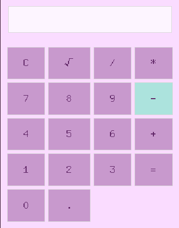

# Калькулятор

Простой калькулятор с графическим интерфейсом на Python и Tkinter. 
Создан в рамках учебного задания.



# # Возможности:
- Сложение, вычитание, умножение, деление.
- Извлечение квадратного корня.
- Ввод как с кнопочной панели, так и с клавиатуры.
- Валидация ввода: буквы и посторонние символы не вводятся.
- Обработка ошибок:
  - деление на ноль;
  - извлечение корня из отрицательного числа;
  - некорректное выражение.
- Поддержка клавиши `Enter` для вычисления результата.

# # Требования:
- Python 3.8 или выше.
- Tkinter.

# # Установка и запуск на linux:
1. Клонируйте репозиторий:
   ```bash
   git clone https://github.com/SonyaShust/pink-calculator.git
   cd pink-calculator
